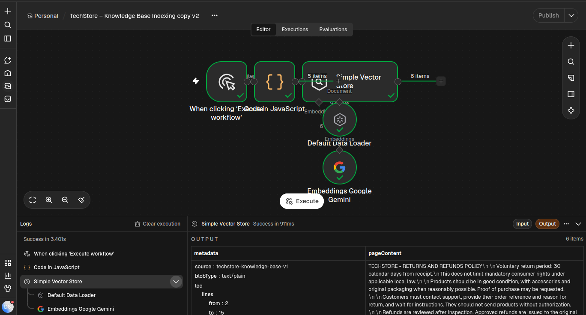
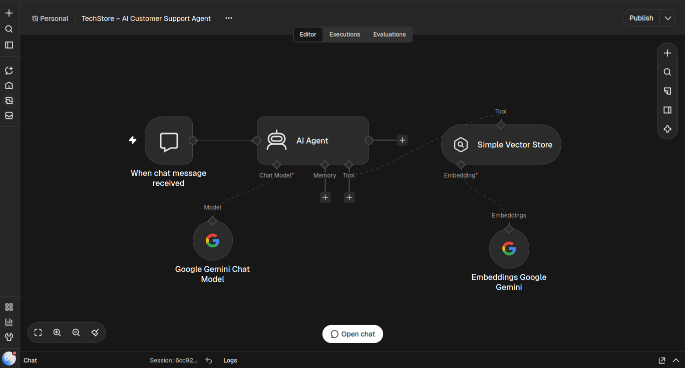

# TechStore – AI Customer Support Agent

**An AI-powered customer support agent built with n8n, Google Gemini and Retrieval-Augmented Generation (RAG).**

[English](#english) | [Español](#español)

**Repository contents:** [Knowledge base](knowledge-base/) · [n8n workflows](workflow/) · [Screenshots](screenshots/)





---

# English

## 1. Project Overview

TechStore is a fictional e-commerce company. This project demonstrates how an AI agent can assist customers by answering questions about returns, refunds, shipping, warranties, billing and customer support.

The agent uses a knowledge base containing internal company policies. Through Retrieval-Augmented Generation (RAG), it retrieves relevant information before generating its answers.

The main objective is to provide helpful, consistent and policy-based responses while reducing inaccurate or unsupported information.

## 2. Project Objectives

- Automate responses to common customer support questions.
- Connect an AI agent to an internal knowledge base.
- Use semantic search to retrieve relevant information.
- Reduce AI hallucinations and unsupported claims.
- Identify situations that require human intervention.
- Demonstrate a practical business use case for AI automation.

## 3. Technology Stack

| Technology | Purpose |
|---|---|
| n8n | Workflow automation and AI agent orchestration |
| Google Gemini | Large Language Model (LLM) |
| Google Gemini Embeddings | Text embedding generation |
| Simple Vector Store | Vector storage and document retrieval |
| RAG | Retrieval-Augmented Generation |

## 4. System Architecture

The solution consists of two independent workflows.

### Workflow 1 – Knowledge Base Indexing

This workflow processes five internal knowledge base documents:

1. Returns and Refunds Policy
2. Shipping Policy
3. Warranty Policy
4. Billing FAQ
5. Customer Support FAQ

The documents are processed, converted into vector embeddings and stored in the Simple Vector Store.

### Workflow 2 – AI Customer Support Agent

The customer sends a message through the n8n chat interface.

The AI Agent can use the Simple Vector Store as a tool to retrieve relevant information from the knowledge base before generating its response.

**Architecture:**

```text
Customer Message
       |
       v
    AI Agent
       |
       +------ Google Gemini Chat Model
       |
       +------ Simple Vector Store
                       |
                       v
              Knowledge Base
                       |
                       v
              Gemini Embeddings
```

## 5. Key Features

- Answers questions using internal documentation.
- Retrieves relevant information through semantic search.
- Responds in Spanish by default.
- Provides information about returns, shipping, warranties and billing.
- Avoids inventing policies, warranty periods or refund conditions.
- Does not claim to access customer accounts or order records.
- Identifies cases that require human support.

## 6. Testing and Validation

Five initial manual functional checks were performed using the n8n chat interface. The checks cover the scenarios listed below; they are not automated regression tests.

| Test scenario | Expected behaviour | Result |
|---|---|---|
| Product returns | Explain the voluntary return period and procedure | Passed |
| Shipping information | Explain estimated delivery times and tracking process | Passed |
| Warranty period | Avoid inventing a warranty duration | Passed |
| Return exceptions | Avoid promising eligibility and recommend human review | Passed |
| Unknown information | Acknowledge limitations and recommend human assistance | Passed |

These tests are initial manual functional checks, not automated regression tests or a formal performance evaluation.

## 7. Current Limitations

- The agent does not connect to a real order management system.
- It cannot verify individual purchases or delivery status.
- It cannot approve refunds or authorize returns.
- Human escalation is recommended by the agent, but no ticket creation or live handoff integration is configured.
- Simple Vector Store uses temporary in-memory storage. Data may be lost when the instance restarts.
- The policies are fictional and intended exclusively for demonstration.

## 8. Future Improvements

The current repository includes a second iteration of the knowledge-base indexing workflow (`knowledge-base-indexing-v2.json`). The following items remain planned improvements:

Planned improvements include:

- Automated human handoff.
- Integration with a customer support ticketing system.
- Persistent vector storage.
- Expanded test coverage and retrieval accuracy evaluation.
- Monitoring and error handling.
- Improved workflow documentation.

## 9. Disclaimer

TechStore is a fictional company created for educational and portfolio purposes.

All policies, documents and customer interactions are simulated. This project is a demonstration of AI automation concepts and is not intended for production use.

---

# Español

## 1. Descripción del proyecto

TechStore es una empresa ficticia de comercio electrónico. Este proyecto demuestra cómo un agente de inteligencia artificial puede ayudar a los clientes respondiendo preguntas sobre devoluciones, reembolsos, envíos, garantías, facturación y atención al cliente.

El agente utiliza una base de conocimientos con las políticas internas de la empresa. Mediante la arquitectura RAG (Retrieval-Augmented Generation), recupera información relevante antes de generar sus respuestas.

El objetivo principal es ofrecer respuestas útiles, coherentes y basadas en documentación, reduciendo la información incorrecta o inventada.

## 2. Objetivos del proyecto

- Automatizar respuestas a consultas habituales de atención al cliente.
- Conectar un agente de IA con una base de conocimientos interna.
- Utilizar búsqueda semántica para recuperar información relevante.
- Reducir las alucinaciones y afirmaciones no fundamentadas de la IA.
- Identificar situaciones que requieren intervención humana.
- Demostrar un caso práctico de automatización empresarial mediante IA.

## 3. Tecnologías utilizadas

| Tecnología | Función |
|---|---|
| n8n | Automatización de workflows y coordinación del agente |
| Google Gemini | Modelo de lenguaje (LLM) |
| Google Gemini Embeddings | Generación de embeddings de texto |
| Simple Vector Store | Almacenamiento vectorial y recuperación de documentos |
| RAG | Generación aumentada mediante recuperación de información |

## 4. Arquitectura del sistema

La solución está formada por dos workflows independientes.

### Workflow 1 – Indexación de la base de conocimientos

Este workflow procesa cinco documentos internos:

1. Política de devoluciones y reembolsos.
2. Política de envíos.
3. Política de garantías.
4. Preguntas frecuentes sobre facturación.
5. Preguntas frecuentes sobre atención al cliente.

Los documentos se procesan, se convierten en embeddings vectoriales y se almacenan en Simple Vector Store.

### Workflow 2 – Agente de atención al cliente

El cliente envía un mensaje a través de la interfaz de chat de n8n.

El AI Agent utiliza Simple Vector Store como herramienta para recuperar información relevante de la base de conocimientos antes de elaborar su respuesta.

**Arquitectura:**

```text
Mensaje del cliente
        |
        v
     AI Agent
        |
        +------ Google Gemini Chat Model
        |
        +------ Simple Vector Store
                        |
                        v
                Base de conocimientos
                        |
                        v
                Gemini Embeddings
```

## 5. Funcionalidades principales

- Responde utilizando documentación interna.
- Recupera información relevante mediante búsqueda semántica.
- Responde en español por defecto.
- Proporciona información sobre devoluciones, envíos, garantías y facturación.
- Evita inventar políticas, periodos de garantía o condiciones de reembolso.
- No afirma tener acceso a cuentas de clientes ni a registros de pedidos.
- Identifica los casos que necesitan atención humana.

## 6. Pruebas y validación

Se realizaron pruebas funcionales iniciales utilizando la interfaz de chat de n8n.

| Escenario de prueba | Comportamiento esperado | Resultado |
|---|---|---|
| Devolución de productos | Explicar el plazo voluntario y el procedimiento | Correcto |
| Información sobre envíos | Explicar los plazos estimados y el seguimiento | Correcto |
| Periodo de garantía | No inventar la duración de la garantía | Correcto |
| Excepciones de devolución | No garantizar la elegibilidad y recomendar revisión humana | Correcto |
| Información desconocida | Reconocer las limitaciones y recomendar asistencia humana | Correcto |

Estas pruebas son comprobaciones funcionales iniciales, no una evaluación formal del rendimiento.

## 7. Limitaciones actuales

- El agente no está conectado a un sistema real de gestión de pedidos.
- No puede verificar compras individuales ni estados de entrega.
- No puede aprobar reembolsos ni autorizar devoluciones.
- Recomienda la intervención humana, pero todavía no realiza escalaciones automáticas.
- Simple Vector Store utiliza almacenamiento temporal en memoria. Los datos pueden perderse cuando se reinicia la instancia.
- Las políticas son ficticias y se utilizan exclusivamente con fines demostrativos.

## 8. Mejoras futuras – Versión 2.0

Las próximas mejoras previstas incluyen:

- Automatización de la transferencia a un agente humano.
- Integración con un sistema de gestión de tickets de soporte.
- Almacenamiento vectorial persistente.
- Ampliación de las pruebas y evaluación de la precisión de recuperación.
- Monitorización y gestión de errores.
- Mejora de la documentación de los workflows.

## 9. Aviso legal

TechStore es una empresa ficticia creada con fines educativos y para la elaboración de un portfolio profesional.

Todas las políticas, documentos e interacciones con clientes son simulados. Este proyecto es una demostración de conceptos de automatización mediante inteligencia artificial y no está destinado a un uso en producción.
